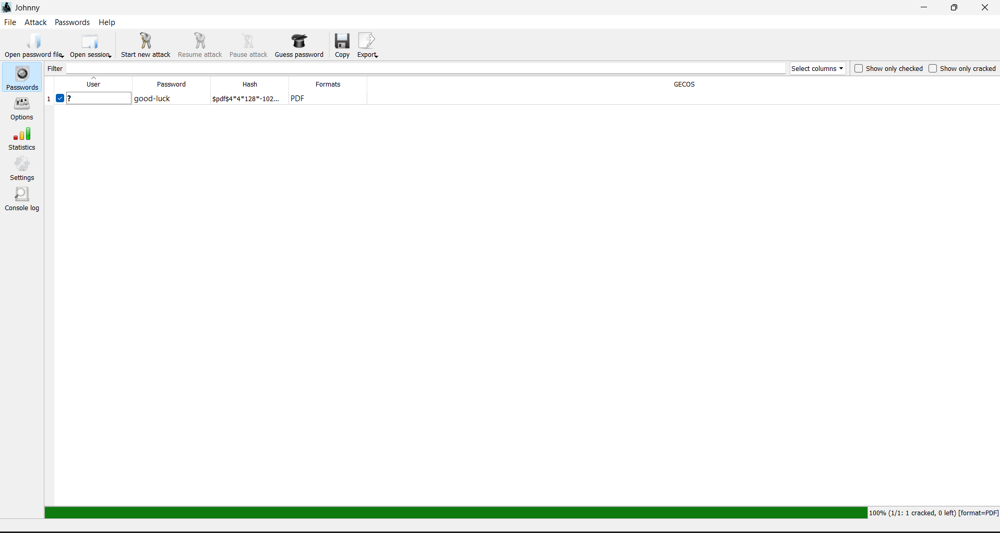
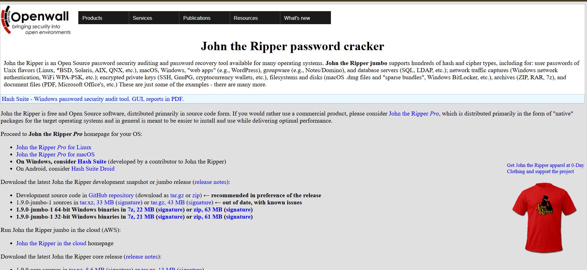
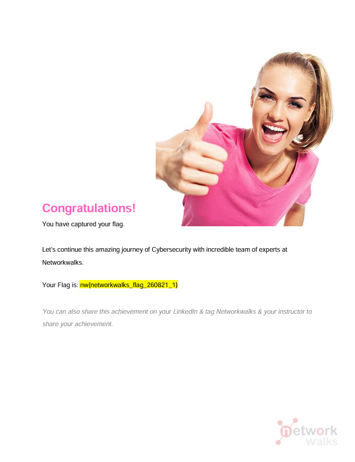
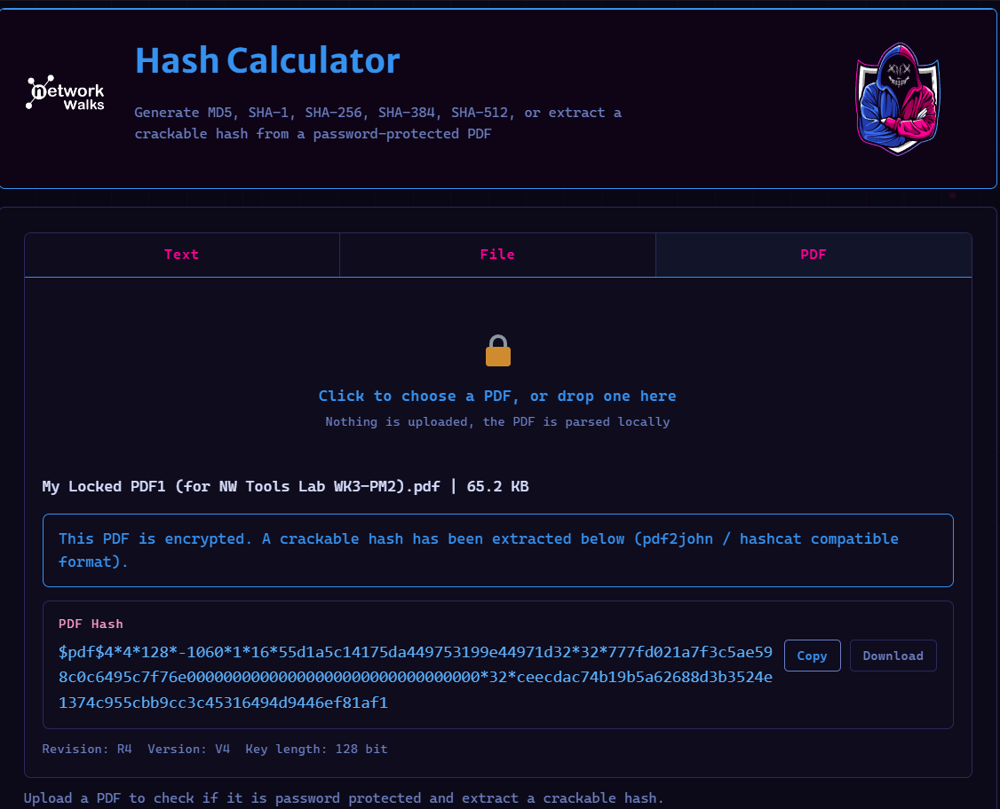
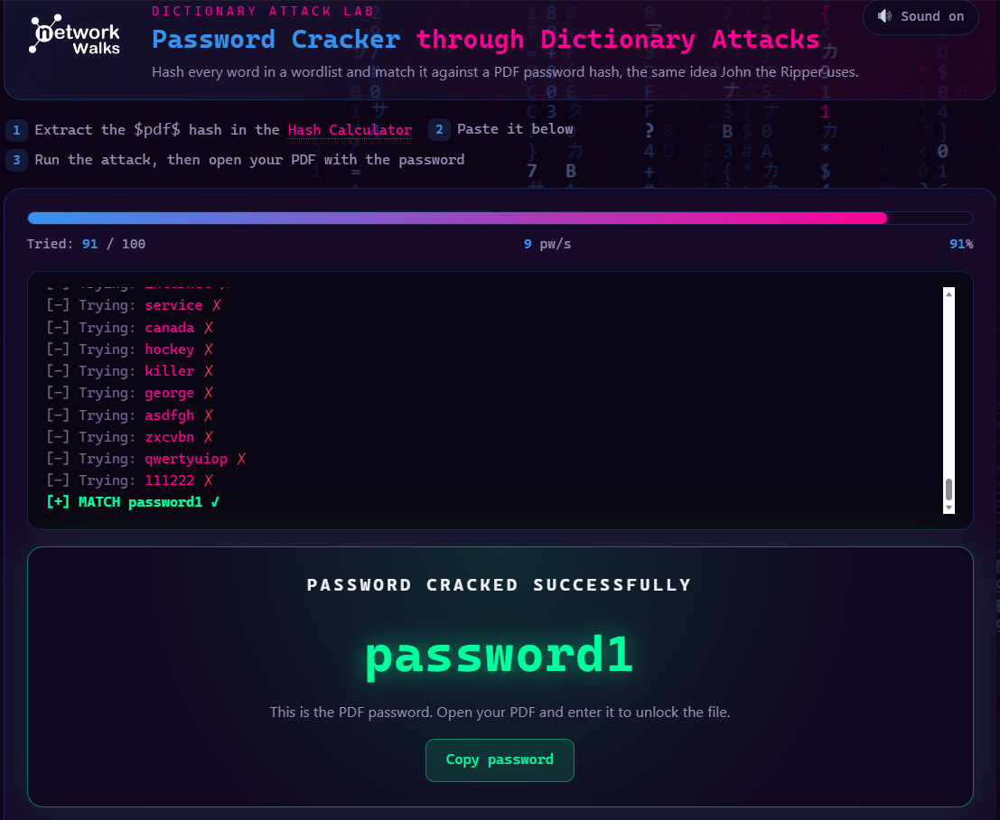
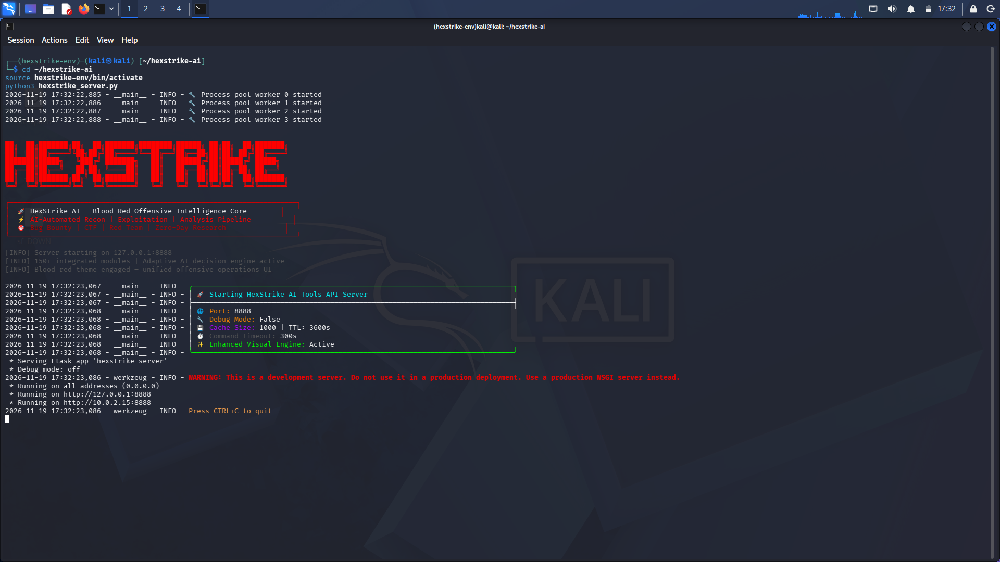
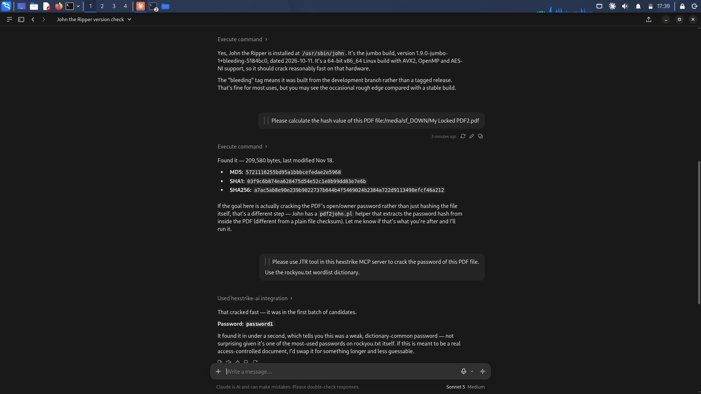

# Week 3 – Password Cracking Labs

Hands-on cybersecurity lab work completed as part of my Week 3 practical activities. This repository documents PDF password-hash extraction, password auditing with John the Ripper (JTR), NetworkWalks password-cracking tools, and an AI-assisted workflow using Claude Desktop with HexStrike MCP on Kali Linux.

> **Lab scope:** These activities were performed against intentionally supplied training files and lab environments for educational purposes. Password auditing and cracking should only be performed on files, accounts, and systems for which I have explicit authorization.

## Repository Overview

| Project | Focus |
|---|---|
| [01 – Password Cracking with JTR](./01-Password-Cracking-JTR/) | John the Ripper, Johnny GUI, and PDF password recovery |
| [02 – Password Cracking with NetworkWalks](./02-Password-Cracking-NetworkWalks/) | PDF hash extraction and dictionary-based password cracking |
| [03 – HexStrike MCP Setup](./03-HexStrike-MCP-Setup/) | Setting up and running the HexStrike MCP server on Kali Linux |
| [04 – AI-Assisted Password Cracking](./04-AI-Assisted-Password-Cracking/) | Using Claude Desktop with HexStrike MCP to interact with John the Ripper |

---

## 1. Password Cracking with John the Ripper

### Objective

Use John the Ripper to audit and recover the password of an intentionally password-protected PDF supplied for the lab.

### Tools Used

- Kali Linux
- John the Ripper (Jumbo build)
- Johnny (graphical interface)
- PDF hash extraction utility
- Wordlist

### What I Practised

- Checking whether John the Ripper is installed and identifying its version.
- Understanding that a password-protected PDF requires extraction of its password hash into a format supported by the cracking tool.
- Loading the extracted hash and testing candidate passwords with a wordlist.
- Reviewing the recovered result through Johnny.
- Understanding how dictionary-based password auditing works.

### Evidence

**Johnny – recovered PDF password**

**John the Ripper – lab persistence flag**

**John the Ripper reference**

---

## 2. Password Cracking with NetworkWalks Tools

### Objective

Practise the PDF hash-extraction and dictionary-attack workflow using the tools provided in the NetworkWalks lab.

### Workflow

1. Select the supplied encrypted PDF in the hash-extraction tool.
2. Extract the PDF password hash in a format compatible with PDF password-auditing tools.
3. Copy the extracted hash into the password-cracking interface.
4. Run the dictionary attack against the lab-provided candidate list.
5. Review the match and use the recovered password to validate access to the supplied PDF.
6. Record the successful lab result.

### What I Practised

- The difference between a normal file checksum and a password-verification hash extracted from an encrypted PDF.
- How dictionary attacks test candidate passwords against a stored hash.
- Why the quality and coverage of a wordlist affect the outcome.
- How to verify a recovered password against the original lab file.
- How hash extraction and password auditing fit together in a practical workflow.

### Evidence

**NetworkWalks – flag captured**

**Additional lab flag evidence**

**PDF hash extraction**

**NetworkWalks hash calculator**

**Dictionary attack – successful password recovery**

---

## 3. HexStrike MCP Setup

### Objective

Set up and run the HexStrike AI MCP server in the Kali Linux lab environment so that an MCP-compatible desktop client can interact with available security tools.

### Environment and Tools

- Kali Linux
- Python virtual environment
- HexStrike AI
- MCP server
- Claude Desktop

### What I Practised

- Activating the project's Python virtual environment.
- Starting the HexStrike server.
- Observing server startup logs and worker initialization.
- Identifying the local listening address and port.
- Understanding the role of an MCP server as an interface between an AI client and external tools.

### Evidence

**HexStrike MCP server running on Kali Linux**

---

## 4. AI-Assisted Password Cracking with Claude and HexStrike MCP

### Objective

Use Claude Desktop as the AI interface to request authorized John the Ripper operations through the configured HexStrike MCP integration.

### Workflow

1. Confirm that John the Ripper is available in the HexStrike environment.
2. Provide the supplied PDF file and request the relevant hash-extraction step required by the lab.
3. Request a John the Ripper dictionary attack against the extracted PDF hash using the lab wordlist.
4. Review the tool output and confirm the recovered result against the training file.

### What I Practised

- How an AI client can call tools exposed through an MCP server.
- How to provide a specific task and file context to an AI-assisted tool workflow.
- How Claude Desktop can interact with security tools through the HexStrike MCP integration.
- Why tool output should be checked rather than blindly trusted.
- The distinction between a file checksum and a password hash suitable for password auditing.

### Evidence

**Claude Desktop – HexStrike MCP and John the Ripper workflow**

---

## Key Concepts Learned

- **Password hash extraction:** Extracting the password-verification data from an encrypted file so it can be tested by a password-auditing tool.
- **Dictionary attack:** Testing candidate passwords from a wordlist rather than trying every possible character combination.
- **John the Ripper:** An open-source password security auditing and recovery tool.
- **Wordlists:** Collections of candidate passwords. Results depend on whether the password is represented in the list and supported by the selected cracking mode.
- **MCP:** A protocol that allows an AI application to interact with external tools through a defined server interface.
- **AI-assisted tooling:** AI can help orchestrate tool use, but the operator remains responsible for authorization, command scope, and validating results.

## Lessons and Takeaways

These practicals helped me connect password-security concepts with hands-on tools. I worked through a conventional John the Ripper workflow, used NetworkWalks tools for PDF hash extraction and dictionary-based password recovery, and configured an MCP server to connect an AI client with security tools.

The AI-assisted exercise also helped me understand how an AI client can interact with local tools through MCP. I learned that AI-assisted execution does not remove the need to understand the underlying tool, check its output, and verify the result.

## Responsible Use

All demonstrations documented here relate to authorized training files and lab environments. Password auditing and cracking should only be performed on files, accounts, and systems that I own or am explicitly authorized to assess. Recovered credentials must not be used outside the permitted lab scope.

## Acknowledgements

Training context: NetworkWalks Week 3 practical labs.
