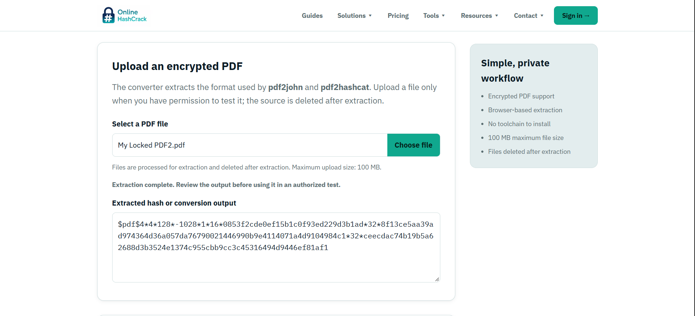
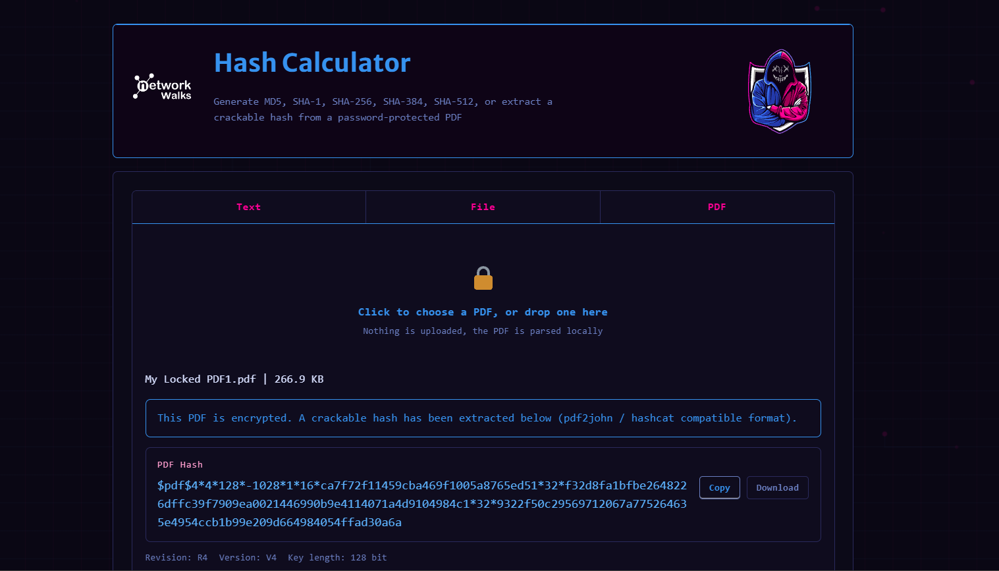
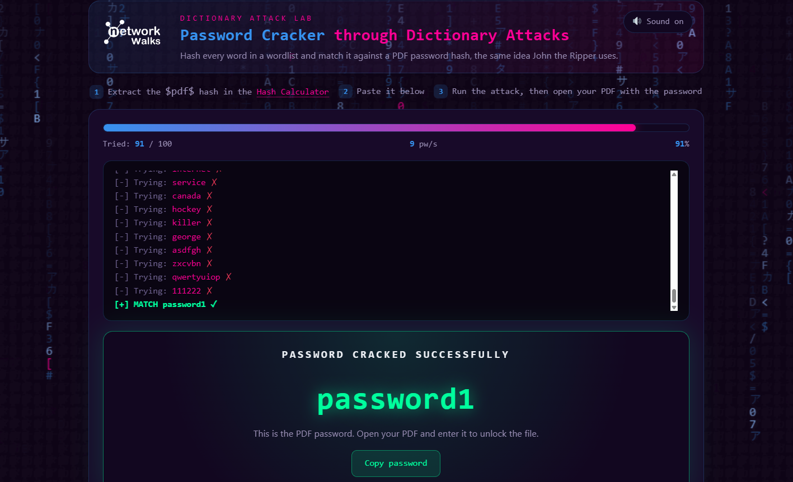

# Week 3 – Password Cracking Labs

Hands-on cybersecurity lab work completed as part of my Week 3 practical activities. This repository documents PDF password-hash extraction, password auditing with John the Ripper (JTR), NetworkWalks password-cracking tools, and an AI-assisted workflow using Claude Desktop with HexStrike MCP on Kali Linux.

> **Lab scope:** These activities were performed against intentionally supplied training files and lab environments for educational purposes. Only test files and systems for which you have explicit authorization.

## Repository contents

| Project | Focus | Evidence |
|---|---|---|
| [01 – Password Cracking with JTR](./01-Password-Cracking-JTR/) | John the Ripper and Johnny GUI; PDF password recovery | Screenshots of the recovered result and JTR reference |
| [02 – Password Cracking with NetworkWalks](./02-Password-Cracking-NetworkWalks/) | Hash extraction and dictionary-based password-cracking workflow using NetworkWalks lab tools | Hash extraction, calculator, attack progress and flag-capture screenshots |
| [03 – HexStrike MCP Setup](./03-HexStrike-MCP-Setup/) | Running the HexStrike MCP server in Kali Linux | Server startup screenshot |
| [04 – AI-Assisted Password Cracking](./04-AI-Assisted-Password-Cracking/) | Claude Desktop interacting with JTR through HexStrike MCP | Claude workflow screenshot |

## 1. Password Cracking with John the Ripper

### Objective
Use John the Ripper to audit and recover the password of an intentionally password-protected PDF supplied for the lab.

### Tools
- Kali Linux
- John the Ripper (Jumbo build)
- Johnny (graphical interface)
- PDF hash extraction utility
- A lab-provided wordlist

### What I practised
- Checking whether John the Ripper is installed and identifying its version.
- Understanding that a password-protected PDF must first have its password hash extracted into a format supported by the cracking tool.
- Loading the extracted hash and testing candidate passwords with an authorized wordlist.
- Reviewing the recovered result in Johnny.

### Evidence

[John the Ripper reference screenshot](./01-Password-Cracking-JTR/screenshots/02-john-the-ripper-reference.png) · [Additional reference view](./01-Password-Cracking-JTR/screenshots/03-john-the-ripper-reference-detail.png)

## 2. Password Cracking with NetworkWalks Tools

### Objective
Practise the PDF hash-extraction and dictionary-attack workflow using the tools provided in the NetworkWalks lab.

### Workflow
1. Select the supplied encrypted PDF in the hash-extraction tool.
2. Extract the PDF password hash in a format compatible with PDF password-auditing tools.
3. Copy the extracted hash into the lab's password-cracking interface.
4. Run the dictionary attack against the lab-provided candidate list.
5. Review the match and use the recovered password to validate access to the supplied PDF.

### What I practised
- The difference between a normal file checksum and a password-verification hash extracted from an encrypted PDF.
- How dictionary attacks test candidate passwords against a stored hash.
- Why the quality and coverage of a wordlist affect the outcome.
- How to verify a result against the original lab file.

### Evidence

## 3. HexStrike MCP Setup

### Objective
Set up and run the HexStrike AI MCP server in the Kali Linux lab environment so that an MCP-compatible desktop client can interact with available security tools.

### Environment and tools
- Kali Linux virtual machine
- Python virtual environment
- HexStrike AI
- MCP server
- Claude Desktop

### What I practised
- Activating the project's Python virtual environment.
- Starting the HexStrike server.
- Observing the server startup logs, worker initialization and local listening address.
- Understanding the role of an MCP server as an interface between an AI client and external tools.

### Evidence

## 4. AI-Assisted Password Cracking with Claude and HexStrike MCP

### Objective
Use Claude Desktop as the AI interface to request authorized JTR operations through the configured HexStrike MCP integration.

### Workflow
1. Confirm that John the Ripper is available in the HexStrike environment.
2. Ask the tool to calculate the relevant file hash / inspect the supplied PDF as required by the lab.
3. Request a JTR dictionary attack against the lab-provided PDF hash using the lab wordlist.
4. Review the tool output and confirm the recovered result against the training file.

### What I practised
- How an AI client can call tools exposed through an MCP server.
- How to provide a specific task and file context to an AI-assisted tool workflow.
- Why tool output should be checked rather than blindly trusted.
- The distinction between a file checksum and a password hash suitable for password auditing.

### Evidence

## Key concepts learned

- **Password hash extraction:** Recovering the verifier data from an encrypted file so it can be tested by an auditing tool.
- **Dictionary attack:** Testing candidate passwords from a wordlist rather than trying every possible character combination.
- **John the Ripper:** An open-source password security auditing and recovery tool.
- **Wordlists:** Candidate-password collections; results depend on whether the actual password is represented in the list and supported by the cracking mode.
- **MCP:** A protocol that allows an AI application to interact with external tools through a defined server interface.
- **AI-assisted tooling:** AI can help orchestrate tool use, but the operator remains responsible for authorization, command scope and validating results.

## Lessons and takeaways

These practicals helped me connect password-security concepts with hands-on tooling. I worked through both a conventional JTR workflow and a tool-assisted workflow, and explored how an MCP server can expose local security tools to an AI client. I also learned to distinguish a normal file checksum from a password hash extracted for password auditing.

## Responsible-use note

All demonstrations documented here relate to authorized training files and lab environments. Password auditing and cracking should only be performed on files, accounts and systems that you own or are explicitly authorized to assess. Do not use recovered credentials outside the permitted lab scope.

## Acknowledgements

Training context: NetworkWalks Week 3 practical labs.
